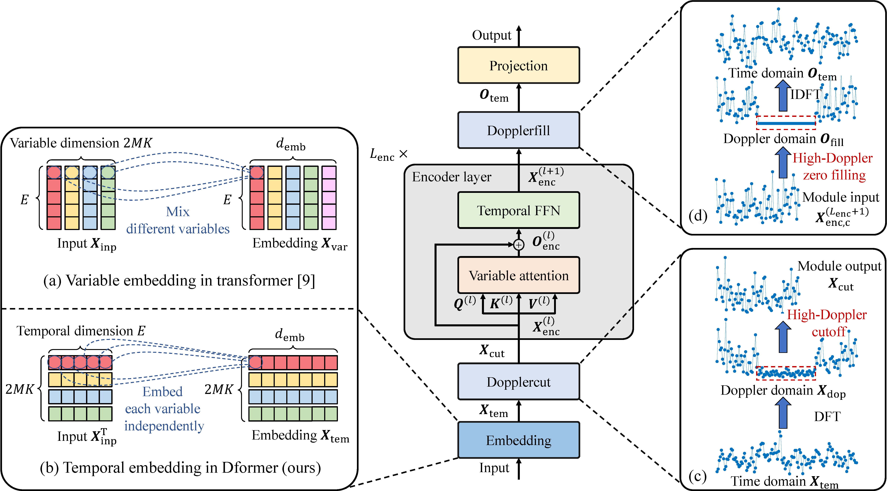

# Doppler-Domain Transformer-Based Channel Prediction with Grouped Cyclic Port Estimation

**Hugging Face downloads:** [Test dataset](https://huggingface.co/datasets/sangyl23/THU_BCSP_CPLib/tree/main/project_Dformer/QuaDRiGa) | [Checkpoints and evaluation commands](https://huggingface.co/datasets/sangyl23/THU_BCSP_CPLib/tree/main/project_Dformer/checkpoint) | [Full artifact repository](https://huggingface.co/datasets/sangyl23/THU_BCSP_CPLib)

PyTorch implementation accompanying **Doppler-Domain Transformer-Based Channel Prediction with Grouped Cyclic Port Estimation** This release provides evaluation code, a QuaDRiGa test dataset, and pretrained checkpoints. Large artifacts are hosted on Hugging Face and downloaded separately from the GitHub source code.

> **Release schedule:** The training datasets, training-data generation code, and Python training scripts will be released immediately after the paper receives a major-revision decision. This README describes evaluation with pretrained checkpoints only; no training dataset is required for the example below.

## Model overview



The figure contrasts variable embedding with Dformer's temporal embedding and illustrates the Dopplercut, variable-attention / temporal-FFN encoder, and Dopplerfill modules. Dopplercut removes high-Doppler components; Dopplerfill restores the sequence length through zero filling before conversion back to the time domain.

## 1. Clone the source code and configure Conda

Run these commands in Anaconda Prompt on Windows:

```bat
git clone https://github.com/sangyl23/THU_BCSP_CPLib.git
cd THU_BCSP_CPLib
conda create -n cplib python=3.11.14 pip=25.3 -y
conda activate cplib
```

Install **PyTorch 2.5.1 with CUDA 12.1** separately before installing the remaining dependencies:

```bat
python -m pip install torch==2.5.1 --index-url https://download.pytorch.org/whl/cu121
```

CUDA 12.1 is the example GPU configuration, you can select the appropriate build for your GPU and NVIDIA driver using the [official PyTorch installation commands](https://pytorch.org/get-started/previous-versions/#v251).

Then install the remaining packages, pinned from the local `cplib` environment:

```bat
python -m pip install -r requirements.txt
```

## 2. Download the test dataset and checkpoints

Run the following commands **from the repository root**, in the activated `cplib` environment.

Download the released test split:

```bat
python -c "from huggingface_hub import snapshot_download; snapshot_download(repo_id='sangyl23/THU_BCSP_CPLib', repo_type='dataset', allow_patterns=['project_Dformer/QuaDRiGa/process_v40kmh_1en3_his64_pre8/test_ULsnr10dB_DLsnr20dB/**'], local_dir='.')"
```

Download the checkpoint directory, including `.pth` weights, configurations recorded in command files, and existing logs:

```bat
python -c "from huggingface_hub import snapshot_download; snapshot_download(repo_id='sangyl23/THU_BCSP_CPLib', repo_type='dataset', allow_patterns=['project_Dformer/checkpoint/**'], local_dir='.')"
```

Project structure:
```text
THU_BCSP_CPLib/
|-- README.md
|-- fig2_model_illustration.png
|-- requirements.txt
|-- models/
|-- layers/
|-- utils/
`-- project_Dformer/
    |-- configs/
    |-- dataloader_cplib.py
    |-- eval_cplib.py
    |-- QuaDRiGa/
    |   `-- process_v40kmh_1en3_his64_pre8/
    |       `-- test_ULsnr10dB_DLsnr20dB/
    |           `-- dataset_*.mat
    `-- checkpoint/
        |-- model_comparison/
        |   `-- QuaDRiGa/
        |       `-- Dformer/
        |           |-- Dformer_QuaDRiGa_v40kmh_interval1en392mats_snr20dB_tt0.pth
        |           `-- running_eval.txt
        |-- port_estimation_mode/
        |-- ablation_study/
        |-- velocity/
        `-- snr/
```

The released split corresponds to 40 km/h, a 1 ms sampling interval, uplink SNR 10 dB, and downlink SNR 20 dB. The examples below use this split. Commands for other velocities, SNRs, or channel datasets require their corresponding test data; downloading their checkpoints alone is insufficient.

## 3. Evaluate Dformer

Switch to the evaluation working directory:

```bat
cd project_Dformer
```

The following command is adapted from `checkpoint/model_comparison/QuaDRiGa/Dformer/running_eval.txt`, using the first CUDA device (`cuda:0`).

```text
python eval_cplib.py --model_name Dformer --channel_type QuaDRiGa --v 40kmh --interval 1en3 --snr 20dB --UE_num 4 --RB_num 8 --M 32 --M_h 8 --M_v 2 --seq_len 64 --pred_len 8 --label_len 32 --t0 64 --read_uplink False --path_train QuaDRiGa/process_v40kmh_1en3_his64_pre8/train_ULsnr10dB_DLsnr20dB --path_eval QuaDRiGa/process_v40kmh_1en3_his64_pre8/test_ULsnr10dB_DLsnr20dB --port_estimation_mode grouped_cyclic_angle_delay --RB_within_group 4 --M_within_group 16 --training_data 92mats --epoch_num 300 --batch_size 16 --gpu cuda:0 --multi_gpu False --cuda_devices 0,1,2,3 --loss_function NMSE --lr 5e-4 --seed 1 --evaluate_sgcs True --evaluate_se True --saved_path checkpoint/model_comparison/QuaDRiGa/Dformer/ --input_mechanism Channel_mixing --instance_norm wo --ifAD True --task_name long_term_forecast --enc_in 128 --dec_in 128 --c_out 128 --e_layers 3 --d_layers 0 --d_model 128 --d_ff 64 --ifemb_conditions False --emb_module temporal_emb --embed_learning doppler --doppler_keep_ratio 0.6 --checkpoint_name Dformer_QuaDRiGa_v40kmh_interval1en392mats_snr20dB_tt0
```

This loads the pretrained Dformer checkpoint and evaluates grouped cyclic angle-delay port estimation with `RB_within_group=4` and `M_within_group=16` (four groups for eight RBs and 32 antenna ports). NMSE, SGCS, and SE evaluation are enabled. The example writes:

```text
project_Dformer/checkpoint/model_comparison/QuaDRiGa/Dformer/eval_result_92mats.mat
```

The MATLAB file contains `nmse_eval`, `sgcs_eval`, `se_eval`, `pre_nodes`, and `gt_nodes`. The script also writes `logfile.txt` in the selected `--saved_path`. Re-running an evaluation overwrites these output files. Large `eval_result_92mats.mat` files are excluded from the published artifacts and regenerated locally during evaluation.

Important path and argument conventions:

- Run from `project_Dformer`, so `QuaDRiGa/...` and `checkpoint/...` resolve correctly.
- `--saved_path` is both the checkpoint directory and output directory. Keep its trailing `/` because the script concatenates file names directly.
- `--checkpoint_name` is the checkpoint file name **without** `.pth`.
- The inherited `--path_train`, `--training_data`, `--epoch_num`, and learning-rate arguments are retained from the recorded command. They do not trigger training; `eval_cplib.py` constructs only the evaluation loader. In particular, `92mats` is a training-run label, not a requirement to download a training set.
- The original `running_eval.txt` files use Bash-style `\` line continuation. On Windows, use the single-line command above, or join the lines before executing. Do not paste the multiline Bash form directly into PowerShell or Anaconda Prompt.

If you are interested in other models and port estimation methods, you can find the corresponding commands from `checkpoint`. For example, for model `Transformer`, you can find the command from `checkpoint/model_comparison/QuaDRiGa/Transformer/running_eval.txt`. For port estimation method `Partial strongest port`, you can find the command from `checkpoint/port_estimation_mode/nmse/partial_strong/SD1of2_FD1of2/running_eval.txt`.

## 4. Parameters instruction

### Channel, data, and port estimation

| Argument | Example value | Meaning |
| --- | --- | --- |
| `--model_name` | `Dformer` | Model implementation to load. |
| `--channel_type` | `QuaDRiGa` | Channel dataset family. Selects the experiment label; the actual files are selected by `--path_eval`. |
| `--v` | `40kmh` | User speed label: 40 km/h. Use test data generated for this speed; changing the label does not modify the data. |
| `--interval` | `1en3` | Sampling-interval label: 0.001 s (1 ms). Must match the test data. |
| `--snr` | `20dB` | Downlink SNR label. The example dataset contains uplink SNR 10 dB and downlink SNR 20 dB. |
| `--UE_num` | `4` | Number of user equipments (UEs) represented per sample. |
| `--RB_num` | `8` | Number of resource blocks (RBs). |
| `--M` | `32` | Total antenna-port count. |
| `--M_h`, `--M_v` | `8`, `2` | Horizontal and vertical array dimensions used by the spatial transform. In this configuration, `M = 2 * M_h * M_v = 32`. |
| `--seq_len` | `64` | Number of historical channel samples supplied to the predictor. |
| `--pred_len` | `8` | Number of future channel samples to predict. |
| `--label_len` | `32` | Decoder context-length setting retained by the shared model interface; this Dformer uses an encoder-only architecture. |
| `--t0` | `64` | Prediction boundary in each channel sequence: history is sliced as `[t0-seq_len:t0]`, and targets as `[t0:t0+pred_len]`. |
| `--read_uplink` | `False` | Whether the data loader also reads uplink channels. This example uses downlink channels. |
| `--path_eval` | `QuaDRiGa/.../test_ULsnr10dB_DLsnr20dB` | Directory containing test MAT files, relative to the `project_Dformer` working directory. |
| `--path_train` | `QuaDRiGa/.../train_ULsnr10dB_DLsnr20dB` | Historical training-path argument. Not read by this evaluation script; the training set is not required. |
| `--port_estimation_mode` | `grouped_cyclic_angle_delay` | Grouped cyclic port estimation in the angle-delay domain. |
| `--RB_within_group` | `4` | Number of RBs in each group. |
| `--M_within_group` | `16` | Number of antenna ports in each group. Together with the RB setting, gives `(8 * 32) / (4 * 16) = 4` groups. |

### Model architecture

| Argument | Example value | Meaning |
| --- | --- | --- |
| `--input_mechanism` | `Channel_mixing` | Input arrangement that combines channel variables for prediction. |
| `--instance_norm` | `wo` | Disables the optional channel-instance normalization. |
| `--ifAD` | `True` | Uses the angle-delay-domain channel input for Dformer. |
| `--task_name` | `long_term_forecast` | Forecasting task selected in the model interface. |
| `--enc_in`, `--dec_in`, `--c_out` | `128`, `128`, `128` | Configured encoder-input, decoder-input, and output feature sizes. Preserve the recorded settings; some fields are shared interface settings rather than active dimensions in every embedding mode. |
| `--e_layers` | `3` | Number of encoder layers. |
| `--d_layers` | `0` | Decoder-layer setting; the selected Dformer is encoder-only. |
| `--d_model` | `128` | Model embedding dimension. |
| `--d_ff` | `64` | Hidden dimension of the feed-forward network. |
| `--ifemb_conditions` | `False` | Disables additional speed/sampling-interval condition embeddings. |
| `--emb_module` | `temporal_emb` | Embeds each channel variable along its temporal dimension. |
| `--embed_learning` | `doppler` | Enables Doppler-domain processing. |
| `--doppler_keep_ratio` | `0.6` | Fraction used to determine the reserving ratio of Doppler spectrum in Dopplercut. |

Arguments omitted from the command use the defaults in `configs/dformer_parameters_setup.py`, including `--dropout 0.08`, `--n_heads 8`, and `--doppler_before_embedding False`. Evaluation disables dropout through `model.eval()`.

### Runtime, metrics, and output

| Argument | Example value | Meaning |
| --- | --- | --- |
| `--batch_size` | `16` | Evaluation batch size; reduce it if memory is insufficient. |
| `--gpu` | `cuda:0` | First visible NVIDIA GPU. Requires a compatible CUDA-enabled PyTorch installation; adjust the device index for your hardware. |
| `--multi_gpu` | `False` | Shared training-interface flag; this evaluation script does not enable multi-GPU execution. |
| `--cuda_devices` | `0,1,2,3` | Shared training-interface device-list argument; it does not select evaluation devices. Evaluation uses `--gpu`. |
| `--seed` | `1` | Seed for Python, NumPy, and PyTorch random-number generators. |
| `--evaluate_sgcs` | `True` | Enables squared generalized cosine similarity (SGCS) evaluation. |
| `--evaluate_se` | `True` | Enables spectral efficiency (SE) evaluation. |
| `--loss_function` | `NMSE` | Recorded experiment setting. The evaluation script computes NMSE directly and constructs a fixed MSE criterion; this flag does not select its evaluation metric. |
| `--training_data` | `92mats` | Training-run label used in experiment and result names, including `eval_result_92mats.mat`; does not specify the number of test files to read. |
| `--epoch_num` | `300` | Historical training-epoch setting; no training epochs run during evaluation. |
| `--lr` | `5e-4` | Historical learning rate; no optimizer updates run during evaluation. |
| `--saved_path` | `checkpoint/model_comparison/QuaDRiGa/Dformer/` | Directory for loading weights and writing results/logs. Must exist and end in `/`. |
| `--checkpoint_name` | `Dformer_QuaDRiGa_v40kmh_interval1en392mats_snr20dB_tt0` | Checkpoint basename without `.pth`. |
